# BillBrief — Build Notes

AI-powered congressional bill tracker + HTML newsletter.

---
## October 22 (evening) — Deployed to Railway 🚀

### Live
- Live at `https://billbrief-production.up.railway.app/` (homepage, bill pages, editor desk).
- Railway project: **BillBrief** service (web) + **Postgres**. The `daily` cron service is next.

### Code changes for production
- `pipenv install gunicorn whitenoise`; `pipenv requirements > requirements.txt`; `.python-version` = `3.13`.
- `settings.py`:
  - `CSRF_TRUSTED_ORIGINS` built from `ALLOWED_HOSTS` (https), `SECURE_PROXY_SSL_HEADER` (Railway terminates HTTPS in front of the app)
  - `SESSION_COOKIE_SECURE` / `CSRF_COOKIE_SECURE = not DEBUG`
  - `WhiteNoiseMiddleware` right after `SecurityMiddleware`; `STATIC_ROOT = BASE_DIR / "staticfiles"`; `CompressedManifestStaticFilesStorage`
  - `dj_database_url.config(conn_max_age=600, conn_health_checks=True)`
- Tested locally first: `collectstatic` (157 files) + `gunicorn config.wsgi --bind 127.0.0.1:8001` (8000 was taken by runserver).
- Secrets check before pushing: `.env` ignored, never tracked, never in git history; added `.env.example` (names only).

### Railway setup
- New Project → Deploy from GitHub repo → BillBrief; + Create → Database → PostgreSQL.
- Web service variables: `DATABASE_URL = ${{Postgres.DATABASE_URL}}` (a **reference**, so it updates itself if the password changes), a **new** `DJANGO_SECRET_KEY` (not the local one), `DJANGO_DEBUG=False`, `DJANGO_ALLOWED_HOSTS=<domain>`, both API keys.
- Settings → Deploy:
  - Pre-deploy: `python manage.py migrate` (tables update on every deploy)
  - Start: `python manage.py collectstatic --noinput && gunicorn config.wsgi --bind 0.0.0.0:$PORT`
- Networking → Generate Domain. `*.railway.internal` is the **private** address (services only), not a public site.

### Problems and fixes
- **Port mismatch:** the domain targeted 8000, Gunicorn listened on Railway's default `$PORT` 8080 → set the domain's target port to 8080.
- **Empty production database** → copied the local data over:
  - `loaddata` over the internet was too slow (one row per round trip; stopped after 40+ min, nothing saved since it's one transaction).
  - ✅ Bulk copy with Postgres's own tools from the Docker container, done in under a minute:
    `docker exec billbrief-db-1 pg_dump -U billbrief -d billbrief --clean --if-exists --no-owner --no-acl | docker exec -i billbrief-db-1 psql "$PROD_DB"`
- **Reaching Railway Postgres from the laptop:** needs a **TCP Proxy** (public host:port). Gotchas:
  - `DATABASE_PUBLIC_URL` appears only once the proxy exists, and the proxy only activates after **applying staged changes** (Deploy banner).
  - The variable editor shows the template (`${{PGUSER}}…`), not the value; I built the URL from the pieces: user, password, proxy domain:port, database.
  - `postgres.railway.internal:5432` doesn't resolve from a laptop; the proxy host is `*.proxy.rlwy.net:<port>`, not 5432.
  - Public endpoint = egress fees; fine for a one-time import, never for the app itself.

### Learned
- Two databases from now on: running `sync_bills` locally updates **only local**; the live site updates via the cron on Railway.
- `&&` runs the second command only if the first succeeded.
- `--bind 0.0.0.0:$PORT` = listen on every address on Railway's port; the default `127.0.0.1` would only accept connections from inside the container.

### To do (tomorrow)
- Cleanup: delete the Postgres TCP Proxy; regenerate the Postgres password; `rm data.json`; `unset PROD_DB`.
- `daily` cron service: same repo, same variables (minus `PORT`), start `python manage.py daily_update`, cron `0 14 * * *` (UTC = 7 AM Pacific), restart policy Never, no domain → test run → check logs.
- README (live link, screenshots, "How I built this with Claude Code"), GitHub Actions CI.

## October 22 — Homepage cards, nav, views cleanup

### Built
- **Recent actions on unapproved cards**: a card without an approved brief now shows the bill's last 4 actions (date + text, newest first) and "Plain-language brief coming after editor review." It replaced the empty dashed "awaiting" box.
  - View: `"recent_actions": bill.actions.filter(action_date__lte=action.action_date).order_by("-action_date", "-id")[:4]` in each card.
  - `action_date__lte` keeps the list consistent with the card's milestone; `"-id"` breaks ties between same-day actions.
  - `_card.html`: `.recent` block in the `` branch, `<time datetime="…">` for accessibility; CSS `.recent`, `.tl`, `.tl li`, `.tl time`, `.pending-note`; `.awaiting` removed.
- **Bell**: now counts final-stage milestones from the **last 7 days** (it was 30), so the number matches "This week" instead of a total that never goes down.
- **Nav `draft_count`**: number of drafts waiting, shown next to Editor desk for editors.

### Fixed
- `recent_action` (singular) in the view vs `c.recent_actions` in the template → renamed. A mismatched name fails *silently* (empty list, no error).
- `draft_count` was inside each card's dict → moved to the page's `render(...)` dict. Card dict = facts about one bill (`c.…`); render dict = things for the whole page.

### Cleanup (views.py)
- Merged and sorted the imports (standard library → Django → app).
- Removed leftover comments and the commented-out old line; fixed comments that no longer matched the code (30 → 7 days; "awaiting" → recent actions).
- `is_editor(request.user)` computed once in `home` instead of twice.

### Decisions
- **Checkpoint 4 is done for version 1.** Briefs feed filters and member one-pagers move to after deploy; with 15–20 bills a week there's nothing to filter yet, and they make good "what I added since" updates.
- Account menu (avatar dropdown) in the nav: optional polish, not a blocker.
- Known difference: the homepage `draft_count` counts all drafts; the desk counts this week's only. Reject stale drafts in the admin if the numbers differ.

### Next: deploy (Checkpoint 5)
- Push everything to GitHub; confirm `.env` is in `.gitignore`.
- Railway account (sign in with GitHub).
- Production settings, Gunicorn, WhiteNoise, Railway Postgres, env variables (API keys go in Railway, never in code).
- Cron service: `python manage.py daily_update` at `0 14 * * *` (7 AM Pacific, every day).
- Then GitHub Actions CI and the README → live link to Jehan and Tak.

- `.env` ignored (`git check-ignore -v .env` → `.gitignore` line 153), never tracked, never in history → no keys to regenerate.
- Added `.env.example` with variable names only.
______________
## October 21
### Built
- **`bills/briefs.py`**: brief generation moved out of the `generate_briefs` command into `create_draft(bill, rewrite=False)`. The command and the desk both call it. `BriefError` holds messages that are safe to show an editor.
- **Editor login**: `django.contrib.auth.urls` at `/accounts/`, `registration/login.html`, `LOGIN_URL` / `LOGIN_REDIRECT_URL = "/desk/"` / `LOGOUT_REDIRECT_URL = "/"`.
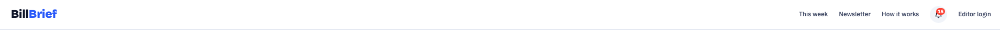
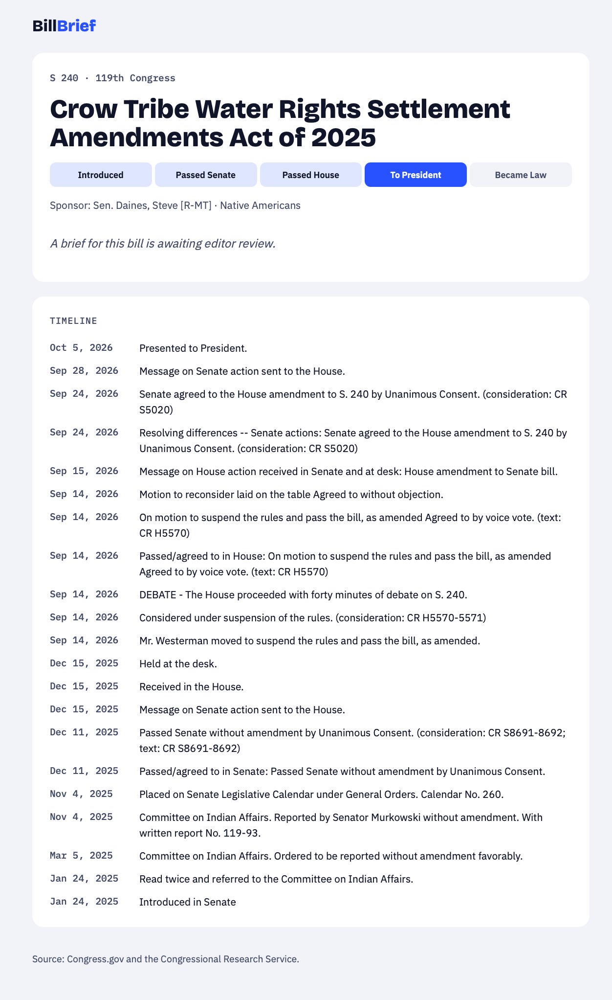

- **Editors group** + `is_editor()` / `@editor_required` (`user_passes_test`). A superuser also passes.
- **`/desk/`**: table of the week's final-stage bills (score ≥ 80) with brief status: no brief → Generate, Draft → Review, Approved → View on site.
- **`/desk/brief/<id>/`**: Review page. Edit the AI explanation (`BriefReviewForm` in `bills/forms.py`; "Who's affected" as one group per line), facts read-only, Approve & publish / Save draft / Reject. Sets `reviewed_by` and `reviewed_at`.
- **Generate button**: POST → `create_draft()` → opens Review. The button turns into "Generating…" so it can't be double-clicked (each click is a paid call).
- **`draft_briefs` command** (`draft_missing_briefs()`): drafts every final-stage bill with no brief for its latest action. Skips any bill with a brief whose `as_of` ≥ its latest action (draft, approved *or* rejected), so it never pays twice or redoes an editor's rejection.
- **`daily_update` command**: `sync_bills --days 2` then `draft_briefs`, via `call_command`. This is what the scheduled job will run.

### Bug: sync missed the Oct 15–19 bills
- **Cause:** `sync_bills --limit` defaulted to 50. It paged correctly but stopped after 50 bills, and newly introduced bills filled those slots.
- **Fix:** `--limit` defaults to 0 = no cap. Added `unchanged(item)`: if the bill exists and the listing's `latestAction` (date + text) matches what's saved, skip the detail and actions calls. Most "updated" bills changed something we don't track (cosponsors, text).
- **Result:** the first full sync is slow (~2 calls per new bill); after that, most bills are skipped. 15 final-stage bills this week (10 on Oct 15, 5 on Oct 14) now match Congress.gov.

### Bug: homepage said 9 presented instead of 12
- `top_bills(... limit=12)` in `home` and `desk` cut 15 bills down to 12 before counting → changed to `limit=50`.

### Decisions
- **Automation drafts, editors publish.** Sync and drafting run on a schedule; a person always approves.
- **Generate** is the fallback for a missed bill or a new draft; the normal path is the daily job.
- **Run daily, including weekends:** `0 14 * * *` UTC = 7 AM Pacific, `--days 2` overlap. Weekend signings and late Congress.gov postings get caught; a quiet day costs about $0 (everything skipped, no AI calls). Weekdays-only + `--days 2` would lose Friday → Saturday updates.
- Logic lives in `bills/*.py`; commands and views are thin wrappers (the same pattern as `importance.py`).

### Learned
- `` and the `registration/` template folder come from Django's built-in auth views; templates go in `bills/templates/registration/`, not inside `bills/templates/bills/`.
- Django 5+ logout requires POST → a form with a button, not a link.
- A `forms.CharField` can override a model's `JSONField` in a `ModelForm`; `clean_<field>()` converts the text back into a list.

## October 19— Tests, editor account, navigation

### Built
- **`bills/tests.py`, 12 tests, all passing** (`python manage.py test bills`):
  - President's deadline: Oct 5 → Oct 16; Oct 14 → Oct 26 (two Sundays skipped)
  - Scoring: Became Public Law = 100; Presented to President = 90 (even though typed Floor); Vetoed = 90; passed one chamber < 80
  - Desk access: logged out → login redirect; regular user → blocked; Editors group → 200
  - Drafts stay private: draft and rejected briefs never on the public bill page; approved shows
- **Editor account** created in admin: in the Editors group, *Staff status off*, so it can use the desk but not the admin. Superuser stays for back-office work.
- **Navigation both ways:**
  - Desk / Review: "View site" link; the brand turns blue on hover.
  - Homepage nav: logged out → **Editor login**; logged in → **Editor desk** · username · **Log out** (POST form).
  - The old Editor desk link had ended up inside the bell's `<details>` dropdown → moved between `</details>` and `</nav>`.

### Learned
- Django's test runner builds a temporary empty database and deletes it after, so real data is never touched.
- An unsaved model instance (`Action(text=..., action_type=...)`) is enough to test pure functions like `score_action`.
- `assertContains` / `assertNotContains` check the rendered HTML, which is the simplest way to test what readers can see.

### Next
- Approve the 14 drafts on the desk.
- **Deploy to Railway**: production settings, Gunicorn, WhiteNoise, Postgres, env variables, then the cron service running `daily_update`.
- GitHub Actions running `manage.py test` on every push.

### Ran (manual, until the daily job is deployed)
- `sync_bills --days 3`: caught up since Monday's sync (3 days, not 2, because the last sync was over 2 days ago).
- `draft_briefs`: drafted briefs for the new final-stage bills; bills that already had a brief were skipped.
- Reviewed and approved some drafts on the desk as the editor; they're now live on the bill pages and homepage cards.
- Rule until deploy: `--days` = days since the last sync + 1; if syncing daily, just `daily_update`.

## October 16

### Site structure decided
- **Public site:** homepage ("This week in Congress"), bill pages, member one-pagers, newsletter preview + signup, How it works, milestone bell.
- **Editor desk (later):** a logged-in page listing this week's top bills with Generate / Review / Approve buttons. Approving updates the bill page, member page and newsletter automatically.
- Alerts: the bell first (facts only, no email); email alerts and subscriber sending in V1.1.
- The newsletter is built from approved briefs only. A bill without an approved brief appears only as a bare fact, or waits a week.

### Built the public homepage (`/`)
- Header with logo, nav and a milestone bell: final-stage actions from the last 30 days, facts only, works without JavaScript.
- Hero: "This week in Congress," the date range, and three stat tiles (became law / sent to the President / editor-approved briefs).
- **Final-stage bills this week:** one row of full-brief cards (number, stage pill, tracker, sponsor and policy area, What it does, Why it matters, Who's affected, CRS note, Latest box with status and deadline). 3 visible, arrows for more; every card the same minimum height.
- Bills without an approved brief keep the same card layout with a dashed "Brief awaiting editor review" box, so no AI text goes public unapproved.
- "Recently published briefs" list, plus Newsletter and How it works teasers.
- The view reuses `top_bills()`, `facts_as_of()` and `tracker_steps()`, with no new logic. The card design lives in one shared template, `_card.html`.
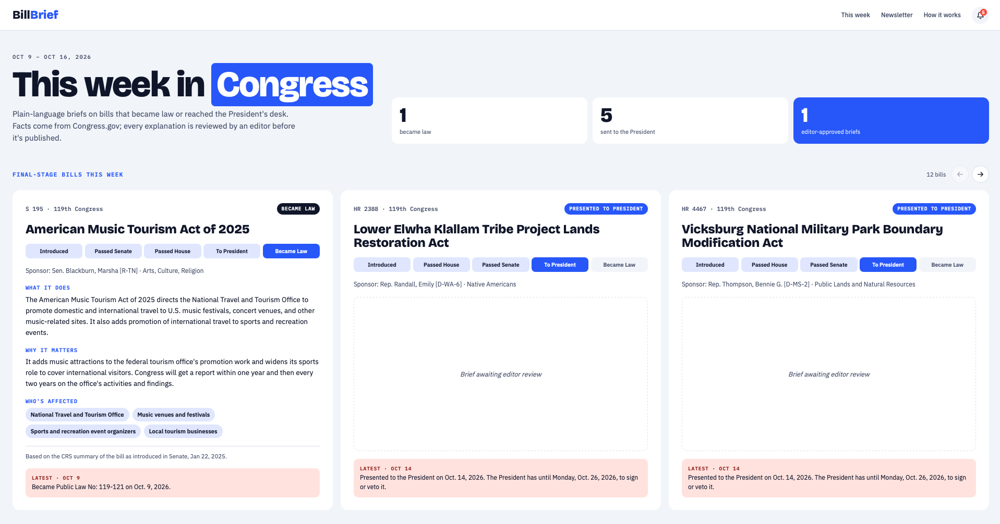

### Iterations
- Narrow centered column → full-width layout with larger type.
- Tried 3 large cards plus a separate scrolling strip; it read as two feeds. Changed to one row with arrows.
- Bug: the scrolling row used percentage-based grid columns, which made the whole page wider than the screen (stat tile and bell cut off). Switched to flexbox.
- Bug: the header's `padding: 16px 0` overrode the page margin, so the logo touched the screen edge.

### Gotchas
- Live Server (port 5500) shows raw template tags; Django pages need `runserver` on port 8000.
- URLs are routes, not file paths: `/`, not `/home.html`.
- Templates go in `bills/templates/bills/`, or Django can't find them.

### Next
- Set `min_score` back to 80; generate and approve briefs for the 5 bills sent to the President Oct 14.
- Newsletter page, How it works page, then deploy.

## October 14

### Bill page shows the new brief versions
- First check showed nothing because I opened it on port 5500 (VS Code Live Server, which renders the raw template with no data) and at `/bill/` instead of `/bills/`. The Django page is `http://127.0.0.1:8000/bills/119-s-195/`.
- The page then showed "awaiting editor review" even though brief 23 was approved: the template still used `overview` in six places after `kind` was removed. Fixed with `sed -i '' 's/overview/brief/g'`.
- S 195 now shows the approved explanation, the "Became law" pill, a "Latest · Oct 9, 2026" box written by code, and the tracker and timeline cut at the brief's `as_of` date.

### Cleaned up the brief admin
- **Bug:** "Reviewed by" and "Reviewed at" stayed empty when I approved by changing the Status dropdown, because only the Approve action filled them. Added `save_model` so the reviewer is recorded however the status changes.
- Facts written by code (stage, status line, what's next) are now **read-only**. Editors check them but don't retype them; if a fact is wrong, the fix belongs in the data or the code.
- The form reads in review order:
  1. **Explanation**, with a "Source" note: copied from an approved brief (the CRS summary hasn't changed), or written fresh by Claude.
  2. **Facts**, shown exactly as readers will see them. "What's next" is hidden when there isn't one.
  3. **Decision**: Status plus one "Reviewed" line.
  4. **Where this came from** (collapsed): as of, CRS version, reused from, model, created.
- Confusion I hit: brief 29 (a test draft) showed "Reused from: …Approved," which looked like it was already approved. It was a new draft reusing approved brief 23's explanation. The Source note now says that plainly.
- Bug: `admin.E035`. The new methods were at the left margin instead of inside `BriefAdmin`, so Django couldn't find them. Indentation again.
- Bill page now says which version the CRS summary describes (e.g. "as introduced in the Senate, Jan 22, 2025"), so readers know when the explanation may not match the final text.
- Generated another 2 briefs: 
  python manage.py generate_briefs --bill hr-5345
  python manage.py generate_briefs --bill s-766 

### End-to-end editorial flow works
1. `python manage.py generate_briefs --bill S-240` creates a **draft** brief: facts from code, explanation from Claude.
2. The public bill page (`/bills/119-s-240/`) shows only the facts and the timeline, with the note "A brief for this bill is awaiting editor review." The draft is never public.
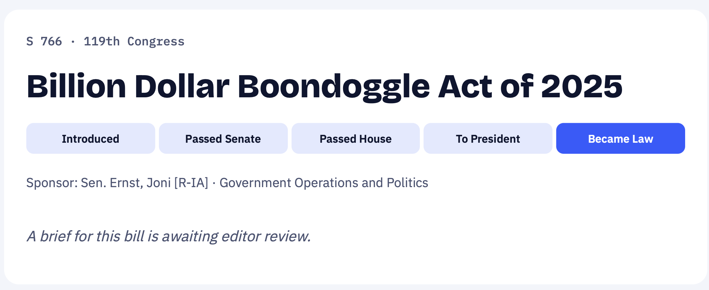
3. In the Django admin, I review the draft (Source note, explanation, facts), edit where needed, and set Status to **Approved**. The reviewer and time are recorded.
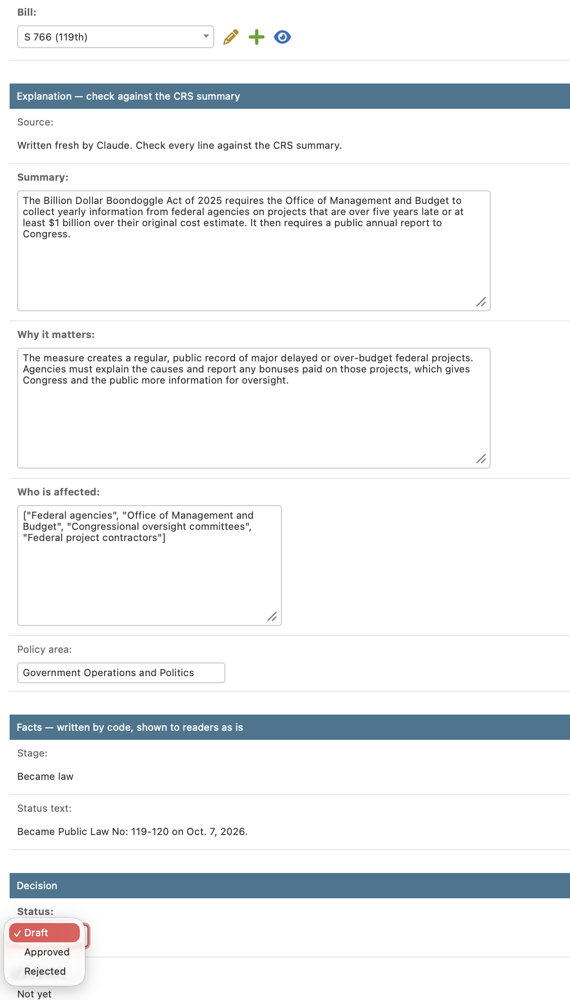
4. Refresh the bill page: the approved brief appears, with the explanation, stage pill, "Latest" box and CRS version note.
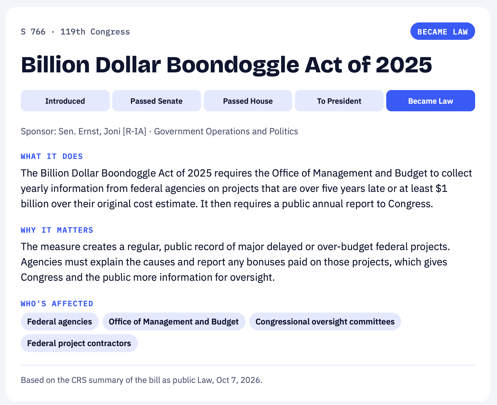

Nothing AI-written reaches readers without an editor's approval.

## October 13

### Questioned the two-brief design
- Each run created two briefs: an overview and a "what changed." Asked why we need both, and the answer didn't hold up: it was one AI call split into two rows that had to be approved separately.
- Generated S 195 with the old code first (briefs 21 and 22) to compare before changing anything.
- Found that the "what changed" brief stored `latest_change` and `whats_next` in columns named `summary` and `why_it_matters`. The admin labels were wrong: "Summary" was really "what happened," and "Why it matters" was really "what's next."
- Lesson: **name columns for what they hold.** Reusing a field for different content saves a migration but makes the data lie.

### Redesigned briefs as versions
- Rules I set:
  - Every milestone creates a new draft, and the page changes only after an editor approves it.
  - The AI explanation is regenerated only when the CRS summary changes; otherwise it's copied from the last approved brief.
  - History for readers is the action timeline.
- Facts move to code: new `bills/status.py` with `facts_as_of(bill, as_of)` returns stage, status line and what's next (including the President's deadline), using only actions up to a date.
- New `Brief` fields: `as_of`, `crs_version`, `status_text`, `whats_next`, and `reused_from` (which approved brief the explanation was copied from).
- The bill page shows the latest approved brief, and cuts the timeline and tracker at its `as_of` date, so the whole page moves together on approval.
- Removed the `kind` field (Overview / What changed). Every brief is now the same kind, one per version.

### Rewrote `generate_briefs`
- Claude now writes only `summary`, `why_it_matters` and `who_is_affected`. Stage, status and next step come from code.
- The prompt tells Claude to use the short title or "the measure," not "the bill" or "the law," so the explanation reads right at any stage.
- `fetch_crs_summary` returns the summary's version (e.g. "Introduced in Senate (2025-01-22)").
- New `--rewrite` flag forces a fresh explanation even if the CRS summary hasn't changed.
- One run = one draft brief.

### Bugs and catches
- **The action timeline was never sent to Claude.** The prompt had the heading "Action timeline (oldest first)" with nothing under it, so Claude only ever saw the CRS summary and one "latest action" line. Fixed. Another "check the input first."
- The pasted file was cut off right after the `try/except`, so the command finished silently with no brief and no error. Found it with `grep` and `tail`.
- Commented out a whole block when only the `kind=` arguments needed to go. Only `, kind=Brief.Kind.OVERVIEW` was tied to the removed field.

### S 195 (American Music Tourism Act), before vs. after
- Before (21 + 22): two briefs; AI wrote "became Public Law"; the summary said "the bill" even though it's law.
- After (23): one brief; code wrote "Became Public Law No: 119-121 on Oct. 9, 2026"; the summary uses the act's name.
- `crs_version` showed the CRS summary describes the **introduced** version (Jan 2025), so the reporting schedule needs checking against the enrolled text before approval.
- Approved 23, then re-ran: "Explanation: reused from brief 23," with no AI call.

### Outreach
- Built a list of 20+ target companies for BillBrief (legislative tech, policy newsrooms, civic tech). Plan: deploy first, then send in waves.

### Next
- Finish the `kind` removal and migrate; check the bill page shows `status_text` and `whats_next`.
- Generate and approve briefs for this week's top bills with the new flow.
- Show "Based on the CRS summary of the [version]" on the bill page.
- Homepage feed, then deploy.
## October 12

### Planned the full content pipeline
- Sketched how a bill moves through BillBrief, then refined it:
  daily sync → score ≥ 80 → instant alert (fact only) → Claude drafts → editor review → approved brief → four products.
- Rules I settled on:
  - **Automation drafts, editors publish.** Briefs are drafted automatically when a bill scores 80+, but nothing AI-written goes public without approval.
  - **Alerts split by audience.** The site bell and the editor email show the bare fact right away (it comes from Congress.gov, not AI). Subscriber emails wait for the approved brief.
  - **The one-pager is assembled automatically** from member data and approved briefs. No extra AI call.
  - **The Friday newsletter is auto-drafted** from the week's approved top 5, and an editor clicks send.
- Updated the content-flow diagram with a "How a bill gets here" row, tagging each step as code, AI or human.

### Member one-pagers: worth it
- One-pager per sponsor when their bill becomes law or reaches the President. National Journal's audience tracks lawmakers, not just bills.
- The trigger is the bill's milestone, not the member's party, so it stays neutral.
- Made a mockup for S 240 (Sen. Steve Daines): a bill brief and a member one-pager side by side.

### President's deadline in code
- Added `bills/deadlines.py`: 10 days, Sundays excepted, counting from the day after presentment. Presented Oct 5 → deadline Fri, Oct 16.
- `generate_briefs` now passes the exact date to Claude in the process note, instead of letting the model guess.
- Bug: `ModuleNotFoundError: No module named 'bills.deadlines'`. The file wasn't saved in the right place; it has to sit in `bills/` next to `models.py`.

### Regenerated and approved the S 240 brief
- The bill page kept showing the old "10 days" text. That's because public pages only show approved briefs, and the new one was still a draft. Approved the new pair and rejected the old pair.
- Editorial catch: the AI dropped the weekday and put "(Sundays excepted)" in an awkward spot. Rewrote it as: "The President has until Friday, Oct. 16, 2026, to sign or veto it."

### Next
- Generate and approve briefs for S 766, HR 5345 and S 2403; regenerate S 283 with the exact deadline.
- Show which version the CRS summary describes.
- Build the homepage feed, then deploy to Railway.

## October 11

### Cross-checked a 28-day ranking with Congress.gov
- `top_bills --days 28` ranked 9 bills correctly, but Congress.gov shows 7 more (S 195, HR 7250, S 759, S 603, HR 5334, S 307, S 32).
- Cause: those bills were never synced. My database was built from partial syncs (3, 7 and 14 days, with caps), never a full 28 days.
- Lesson: rankings are only as complete as the sync. Weekly runs are fine if every week is fully synced; looking back needs a backfill.
- Later: skip unchanged bills in `sync_bills` (compare `updateDate` with `api_update_date`), and add a `sync_laws` command using the API's `/law/{congress}` endpoint.

### Fixed the bill page tracker
- Bug: all 5 of this week's top bills showed "Introduced" on the tracker.
- Cause: the tracker read its stage from the approved AI brief. With no approved brief, the stage was `""`, which fell back to step 0.
- Fix: added `tracker_position(bill)`, which works out the step from the bill's actions (became law → presented/vetoed → passed both → passed one → introduced). The tracker no longer depends on the AI or approval.
- The blue stage pill still shows the AI's stage from the approved brief. If the pill and tracker disagree, the brief needs editing.
- Principle: facts (where a bill is) come from code and data; the AI only writes the explanation.

## October 10

### Understanding the Congress.gov API structure
- Read the API docs (`/bill`, `/bill/{congress}/{type}/{number}`, `/actions`, `/summaries`) and compared their JSON to my models.
- Mapped the action JSON to the `Action` model: `actionDate` → `action_date`, `text` → `text`, `type` → `action_type`, `actionCode` → `action_code`. `sourceSystem` is skipped; my unique rule (bill + date + text) already removes duplicates.
- The bill list comes back **oldest update first** by default. Added `sort="updateDate desc"` (it needs a real space: `updateDate+desc` was silently ignored) and paging with `offset`.

### "Updated" doesn't mean "something happened"
- Synced 300 bills from the last 3 days. The top of the list was mostly new bills (2 actions = introduced + referred) and resolutions.
- `[updated], 0 new actions` means the record changed on Congress.gov (text, cosponsors, summary), not that Congress acted.
- "N new actions" counts actions new to *my database*, not new this week. The real signal is `Action.action_date`.
- Used the Django shell to filter the real events from the week: S 766 became law, House Small Business reported 8 bills in one markup, and Veterans' Affairs reported HR 7683.
- Shell = scratchpad for exploring data. Once something works, it moves into real code.

### Importance scoring
- Created `bills/importance.py` (shared logic) and a `top_bills` management command (a thin wrapper to print results). Logic lives in the app, so the homepage and newsletter can use it too.
- Each action gets points; a bill's score is its best action of the week.
- Editorial rule: **max 5 briefs a week, minimum score 80** (resolving differences, sent to President, vetoed, became law).
- Action types in my data: IntroReferral 1,202 · Floor 531 · Committee 417 · Calendars 78 · Discharge 18 · President 12 · Veto 5 · ResolvingDifferences 2 · NotUsed 2. More than half is introductions and referrals.
- Switched from text phrases to the API's `type` field, with text only to refine Floor and Committee.
- **Real data didn't match the docs:** "Became Public Law" is typed `President` (not `BecameLaw`), and "Presented to President" is typed `Floor`. Final-stage milestones are now matched by text, and everything else by type.
- Bugs I hit: `min_score=60` in the function default hid the committee reports; an old `score_action` without the law check scored S 766 at 90.

### Stages and tracker
- Aligned the brief `stage` enum with Congress.gov's status categories (kept "Presented to President").
- The enum is a multiple-choice list for the AI: it reads the timeline and picks one, and the editor checks it.
- Added a 5-step status tracker to the bill page; the order depends on the origin chamber.

### Cross-check with Congress.gov
- Congress.gov showed 5 bills meeting my criteria this week; my ranking showed 3.
- HR 5345 (law) and S 2403 (presented) were missing because they were never synced: the 300-bill cap with newest-first sorting cut them off.
- Fix: the weekly run syncs the full 7 days without a tight cap (`--days 7 --limit 2000`).
- Lesson: the ranking was right, but the input was incomplete. Check the input first.
- The output gives 5 important updates for the last 7 days:
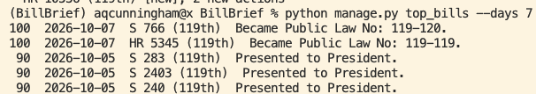
- Corresponds to the same 5 bills from Congress.gov:
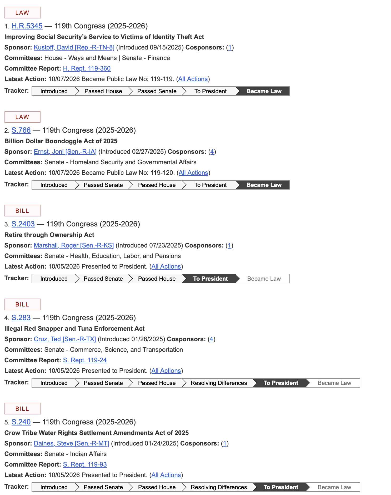

### Next
- Generate and review briefs for this week's 5 bills.
- Add a "Resolving Differences" tracker step when a bill went through it.
- Build the homepage feed.

## October 9 — README

- Rewrote README.md: what works today, design principles, concept designs, stack, local setup, roadmap, link to build log
- Labeled mockups as "Concept designs" so they aren't mistaken for built features
- Renamed image files to remove `&`, which can break Markdown image links

## October 8 — Production settings

**Moved secrets and environment settings out of `settings.py`**
- Generated a new secret key:
    python -c "from django.core.management.utils import get_random_secret_key; print(get_random_secret_key())"
- Added to `.env`: `DJANGO_SECRET_KEY`, `DJANGO_DEBUG=True`, `DJANGO_ALLOWED_HOSTS=localhost,127.0.0.1`
- In `settings.py` (after `load_dotenv()`):

    SECRET_KEY = os.environ["DJANGO_SECRET_KEY"]
    DEBUG = os.environ.get("DJANGO_DEBUG", "False") == "True"
    ALLOWED_HOSTS = os.environ.get("DJANGO_ALLOWED_HOSTS", "").split(",")

- Why: the original key from `startproject` was committed to the public repo; DEBUG now defaults to False (safe for production); ALLOWED_HOSTS will get the live domain on Railway
- Checked `git diff config/settings.py` for secrets before committing

**Lesson: `os.environ["X"]` vs `os.getenv("X")`**
- `os.environ["X"]` fails immediately with a clear error naming the missing variable; use it for required secrets
- `os.getenv("X", default)` returns None or a default silently; use it for optional settings with a safe default

## October 7 - Current-Congress sync, Anthropic setup

**1. Created a superuser** and confirmed all 3 models (Member, Bill, Action) in the Django admin.
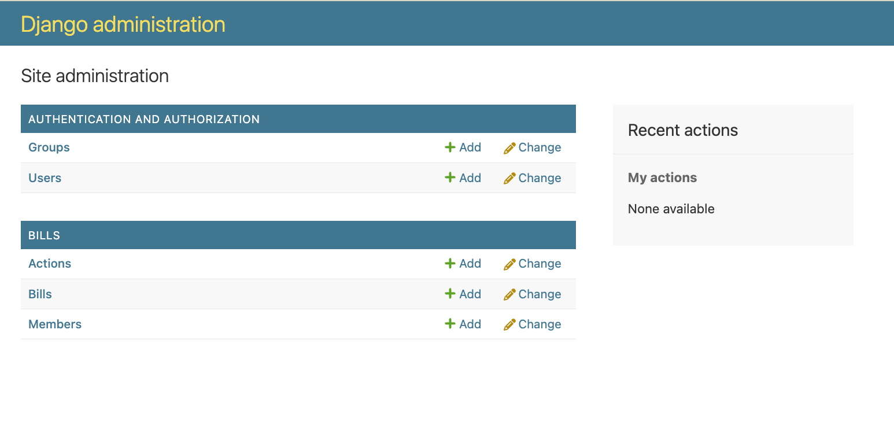

**2. Scoped the sync to the current (119th) Congress**

- Problem: the sync returned 117th Congress bills (2021–22). The `fromDateTime` filter matches bills whose *records* were recently updated, including old bills touched by Congress.gov's data cleanup.
- Fix: added a `--congress` option (default 119) and changed the request from `/bill` to `/bill/{congress}`:

    parser.add_argument("--congress", type=int, default=119, help="Congress number")

- Result: the sync now returns only current bills (HR 45, HR 31, HR 211, HR 220, HR 227).
- Lesson: "updated" in an API often means the database record changed, not that something happened in Congress. Change tracking should rely on the Action table instead.

**3. Set up the Claude API**

- Created an API key in the Claude Console, named `billbrief-local` (stored in `.env` only)
- Installed the SDK: `pipenv install anthropic`

**4. Brief model and editorial workflow**

- Added a `Brief` model linked to `Bill`: summary, why it matters, who's affected, stage, `kind` (overview or what changed), and `status` (draft / approved / rejected)
- Audit fields: `reviewed_by`, `reviewed_at`, `model_name`
- Admin actions to approve or reject briefs in bulk; list shows ID, kind, and status

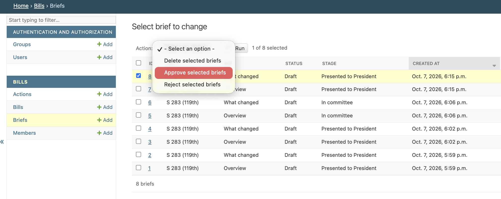

**5. generate_briefs command (Claude API)**

- Sends one bill to Claude with its title, sponsor, CRS summary, and action timeline; saves an overview brief and a "what changed" brief as drafts
- Structured output via a `save_brief` tool schema, so every brief has the same fields

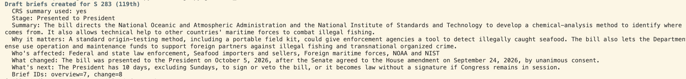

Iterating on S. 283 (Illegal Red Snapper and Tuna Enforcement Act, presented to the President Oct 5):

1. Error: `tool_choice` type "tool" isn't supported for this model → switched to `auto`, with the system prompt requiring the tool call plus a guard if none comes back.
2. Draft 1: accurate, but long sentences, jargon ("IUU"), crammed labels → tightened the schema descriptions (word limits, short labels, spell out acronyms).
3. Draft 2: "What's next" told readers "the input does not give a deadline" → the code now supplies the constitutional 10-day rule when a bill reaches the President; the prompt forbids mentioning the input.
4. Draft 3: stage regressed to "In committee" → printed the exact context in the Django shell to debug; added the latest action near the top of the input.
5. Draft 4: correct. Approved briefs 7 and 8, rejected 1–6.

Principles:
- The code supplies the facts; the model only writes.
- When AI output looks wrong, check the input first.
- Edits to the brief happen on the edit page; approval happens through admin actions so the audit trail is recorded.

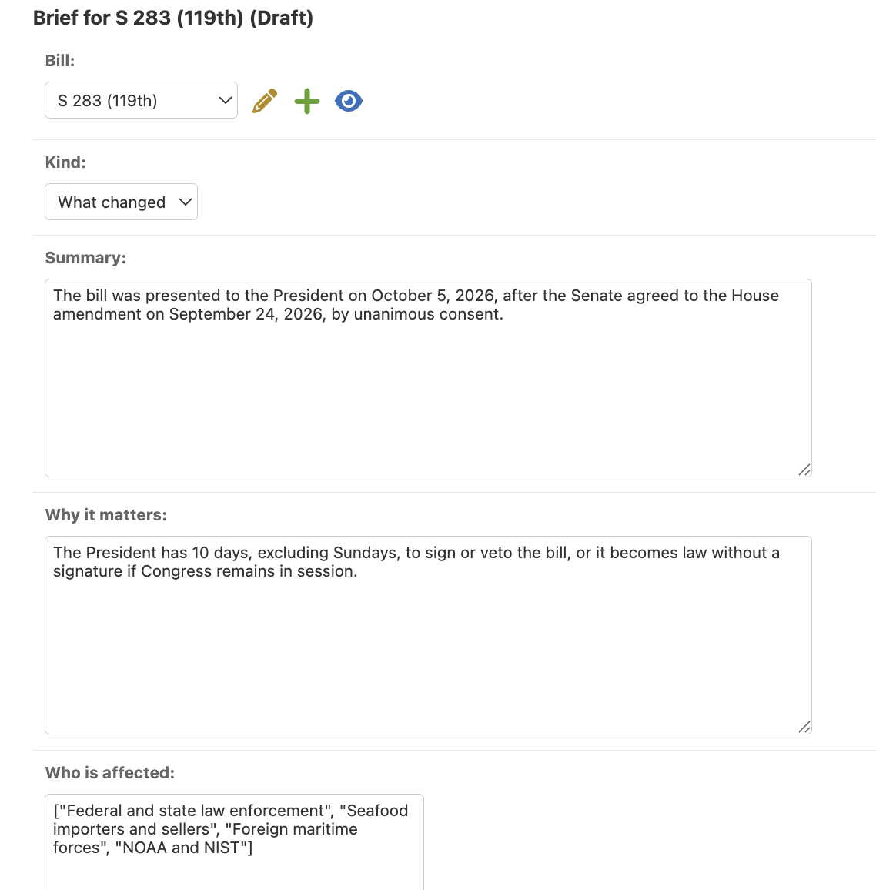

**6. Admin display**

- Times showed in UTC; set `TIME_ZONE = "America/Los_Angeles"` (the database still stores UTC)
---

## October 6 — Environment, Postgres, first sync

**1. Set up the environment**

```bash
pipenv shell
pipenv install django djangorestframework "psycopg[binary]" requests dj-database-url python-dotenv
django-admin startproject config .   # "config" = settings package; "." keeps manage.py at the repo root
python manage.py startapp bills      # the app
python manage.py runserver
```
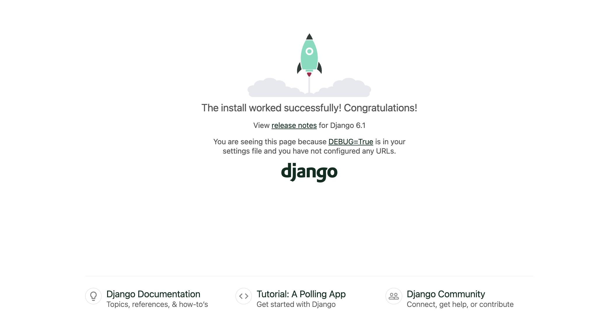

**2. Pushed progress**

```bash
git add .
git commit -m "..."
git push
```

- Problem: push failed with `Failed to connect to github.com port 443`.
- Debugged: `curl -I https://github.com` returned 200, no proxy configured; it was a temporary network drop. Push succeeded on retry.

**3. Installed Docker Desktop** to run PostgreSQL locally

- Problem: `docker: command not found` right after install.
- Fix: the terminal was opened before Docker was installed; a fresh terminal picked up the new PATH.

**4. Postgres via Docker Compose**

- Created `docker-compose.yml` at the repo root (same level as `manage.py`)
- Ran `docker compose up -d`

**5. Config**

- Created `.env` with the Congress.gov API key and `DATABASE_URL` (confirmed with `git status` that `.env` is ignored)
- In `config/settings.py`:

```python
import dj_database_url
from dotenv import load_dotenv
load_dotenv()

DATABASES = {"default": dj_database_url.config()}
```

- Added `rest_framework` and `bills` to `INSTALLED_APPS`

**6. Models and ingestion**

- Models: `Member`, `Bill`, `Action`
- Ingestion command: `bills/management/commands/sync_bills.py`

```
bills/
├── models.py
└── management/
    ├── __init__.py
    └── commands/
        ├── __init__.py
        └── sync_bills.py
```

**7. Migrated and ran the first sync**

```bash
python manage.py makemigrations
python manage.py migrate
python manage.py sync_bills --days 3 --limit 5
```

- Problem: `ModuleNotFoundError: No module named 'django'`.
- Debugged: `which python` pointed to an old virtualenv (`...-O9mgv4Bi`) left over from an earlier install in the wrong folder, while `pipenv --venv` showed the project's real one (`...-m0y9PZYD`). Exited the stale shell, re-ran `pipenv shell`, and it worked.
- Also: first tried running migrations from the wrong folder level.

**8. Registered the 3 models in `admin.py`**

**Result:** sync worked: 5 bills saved to Postgres with actions.

- Finding: all 5 were from the **117th Congress**. The `fromDateTime` filter returns bills whose *records* were recently updated, which includes old bills. Next step: scope the sync to the current (119th) Congress.
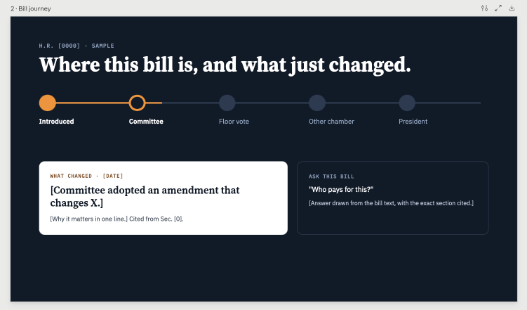


---

## October 5 — Repo setup

1. Requested a Congress.gov API key (stored in `.env` only, never committed)
2. Created the GitHub repo: README, Python `.gitignore`, MIT license
3. Cloned it: `git clone https://github.com/aqcunningham/BillBrief.git`

---

## October 4 — Research and planning


**Visual ideas:** briefs feed, bill journey timeline, BillBrief Weekly email (see the BillBrief Visual Concepts canvas)