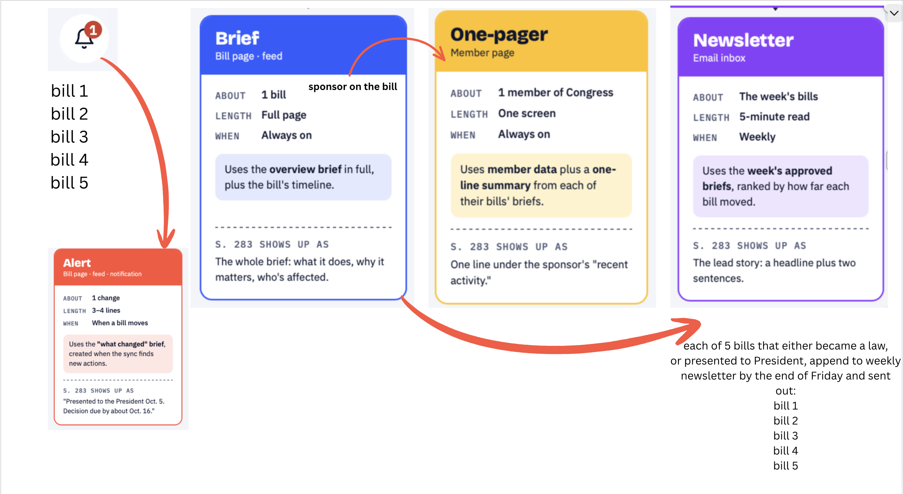
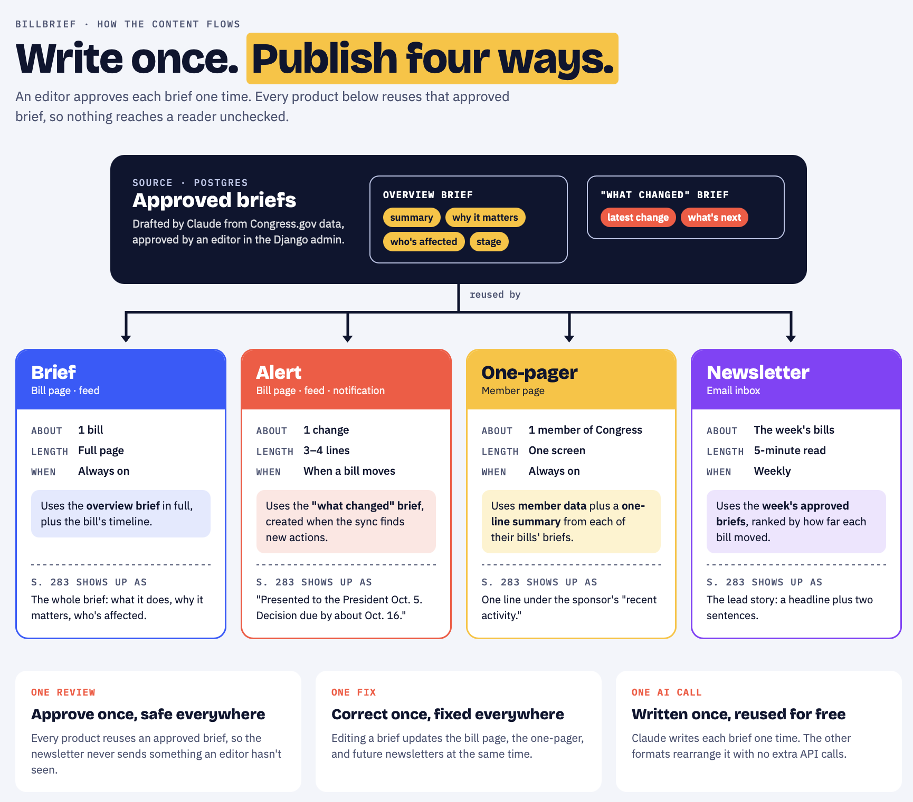
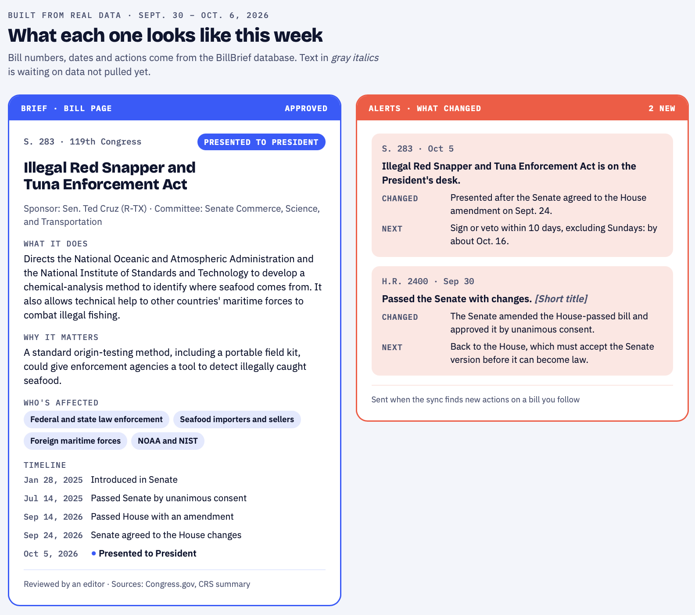
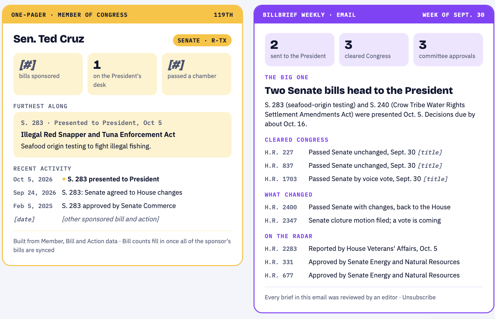

# BillBrief

**Plain-language briefs on bills that just reached the President or became law, drafted by Claude, approved by an editor.**

🔗 **Live: [https://billbrief-production.up.railway.app](https://billbrief-production.up.railway.app)**

Every morning, BillBrief syncs new congressional actions from the Congress.gov API, finds the bills that reached a final stage, and drafts a brief for each. Code writes the facts. Claude writes only the explanation. Nothing is published until an editor approves it.


## How it works

```
7 AM Pacific, every day (Railway cron)
  │
  ├─ 1. sync_bills     Congress.gov → PostgreSQL. Skips bills whose latest action hasn't changed.
  ├─ 2. top_bills      scores every action; keeps the final stages (presented, signed, became law, vetoed)
  └─ 3. draft_briefs   one draft per new milestone
          ├─ facts      stage, status, the President's signing deadline   ← written by code
          └─ explanation what it does, why it matters, who's affected     ← written by Claude
                          (reused at no cost when the CRS summary hasn't changed)
  ▼
Editor desk → review, edit, approve → public homepage and bill page
```

## What works today

- **Daily automation:** a scheduled job syncs new actions and drafts briefs on its own. A quiet day costs about $0: unchanged bills are skipped, and the same milestone is never drafted twice.
- **Importance scoring:** ranks every legislative action; final stages (became law, presented to the President, vetoed) score 80+. Matches on action text, because Congress.gov's action types don't line up with milestones (e.g., "Presented to President" is typed *Floor*).
- **Facts from code:** stage, status line and the President's 10-day signing deadline (Sundays excepted) are computed from the official actions, never generated.
- **AI explanations:** Claude turns the CRS summary and action timeline into a structured explanation, enforced with a tool schema. Each brief records which CRS summary version it was based on.
- **Editor desk:** a login-protected page for the Editors group. It lists the week's final-stage bills with their brief status, lets editors generate a draft, and opens a review page to edit, approve or reject. Who approved what, and when, is recorded.
- **Public site:** homepage with this week's final-stage bills, bill pages with a status tracker and timeline, and a milestone bell. Only approved briefs are ever shown; until then a card shows the bill's latest official actions.


## Design principles

- **The code supplies the facts; the model only explains.** Anything that can be wrong in a costly way (dates, status, deadlines) is computed, not generated.
- **Automation drafts, editors publish.** Human review is a feature, not a fallback. Review caught a misleading status and an imprecise acreage figure before either reached a reader.
- **When AI output looks wrong, check the input first.** See the build log for real examples.
- **Don't pay twice.** Explanations are reused when the source summary is unchanged; the sync skips bills with nothing new.
- **Writing style** follows Smart Brevity principles ("why it matters," "what's next").

## How I built this with Claude

I built BillBrief with Claude as a coding agent: I scoped each change, reviewed every diff, and tested before committing. Some places where the agent's first answer was plausible but wrong, and how I caught it:

- **Missing bills.** The sync looked correct but silently stopped at 50 bills per run, so a week's final-stage bills never arrived. I caught it by cross-checking the results against Congress.gov, then fixed the cap and added a skip for unchanged bills.
- **Missing context.** Briefs were vaguer than expected. Checking the input first showed that the action timeline heading was in the prompt, but the actions themselves weren't.
- **Confusing design.** A first brief-versioning design had two kinds of briefs that editors would have to approve separately. I rejected it as confusing and redesigned it: one brief per milestone, facts from code, explanation reused when nothing changed.
- **Status mismatch.** Congress.gov marks a bill as law at "Signed by President," days before "Became Public Law No. …" is posted. I spotted the mismatch on the live site and fixed the tracker and scoring.

## Tests

12 tests (`python manage.py test bills`): the President's deadline math, importance scoring, desk access (logged-out, regular user, editor), and that draft and rejected briefs never appear publicly.

## Stack

Python · Django · PostgreSQL · Claude API · Congress.gov API · Railway (web + cron) · Gunicorn · WhiteNoise · Docker Compose (local)

## Run it locally

    docker compose up -d
    pipenv install && pipenv shell
    cp .env.example .env          # then fill in the values
    python manage.py migrate
    python manage.py createsuperuser
    python manage.py daily_update    # sync + draft briefs
    python manage.py runserver

Needs a `.env` with `CONGRESS_API_KEY`, `ANTHROPIC_API_KEY`, `DATABASE_URL`, `DJANGO_SECRET_KEY`, `DJANGO_DEBUG` and `DJANGO_ALLOWED_HOSTS` (see `.env.example`).

## Concept designs

How one approved brief feeds four products: the bill brief, alerts, member one-pagers, and the weekly newsletter.






## Roadmap

- GitHub Actions CI on every push
- Member one-pagers for sponsors
- Weekly newsletter, auto-drafted from approved briefs
- Briefs feed with filters by stage and policy area
- "Similar bills" with pgvector embeddings
- Next.js frontend over a JSON API

## Build log

Day-by-day progress, including the problems I hit and how I solved them: [NOTES.md](NOTES.md)